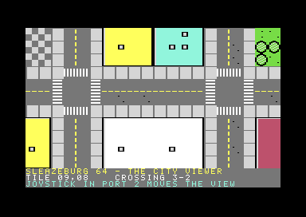

# Sleazeburg 64

A top-down crime satire for the **Commodore 64**, written in 6502 assembly. It is the real-hardware version of
the [browser game of the same name](https://mselin.github.io/gta-c64/), which only pretends to be a C64 game.



## Status

Early. Milestone 1 is done (in the emulator) and **milestone 2, a city with things in it, is under way**:
traffic, getting out of the car and walking, and Big Honk. The program draws the city of Sleazeburg in
multicolour character mode, and you drive a car around it with a joystick in port 2 while the view scrolls
smoothly to follow. The car handles like the browser game's: it speeds up, brakes, reverses, slides when you
turn fast, turns tighter on the handbrake, has less grip on grass, and bounces off buildings and trees. A
handful of other cars drive the streets on their lanes, turn at crossings and stop behind whatever is in front
of them, you included; your car bounces off them, and a car you hit hard is wrecked. You can get out and walk,
swim across the canal, and get into any car, a passing one included. Drive into the canal or a fountain and
the car wades, slower the deeper it goes, until it floods and sinks, leaving you swimming. Big Honk, the goose who runs Sleazeburg,
wanders The Moat, the canal down the middle of the city; nothing hurts him, and a car that runs into him only
makes him flap and run off. A raster split keeps the status panel still under the city, on black. There are no
other people, no sound and no game yet. See [docs/ROADMAP.md](docs/ROADMAP.md) and the
[issues](https://github.com/mselin/Sleazeburg64/issues) for what comes next.

The streets are the same ones as in the browser game: both versions generate the city from the same code and
the build checks that they still agree.

## Build

You need [64tass](https://tass64.sourceforge.net/), Node.js 20 or later, and `make`.

```bash
make
```

That writes `build/sleazeburg64.prg`.

## Run

In a browser: <https://mselin.github.io/Sleazeburg64/> has the latest tested build, playable in VirtualC64 Web
(see [docs/BROWSER.md](docs/BROWSER.md)) or to download.

On a real C64 or C128 in 64 mode: copy the `.prg` to a disk, SD card or cartridge of your choice, plug a
joystick into **port 2**, then `LOAD` and `RUN` it. The program is for PAL machines; it has not been tried
on NTSC.

- **In the car:** up accelerates, down brakes and then reverses, left and right steer, and fire is the
  handbrake. Standing still or nearly, with the stick centred, a press of fire gets you out.
- **On foot:** the stick walks you eight ways. Standing by a car, with the stick centred, a press of fire gets
  you in.

In [VICE](https://vice-emu.sourceforge.io/), if it is installed with C64 ROMs:

```bash
make run
```

## Test

```bash
make test
```

This runs three things:

1. **Tool tests** (`tools/*.test.mjs`): the city generator, the asset files and the tune tool.
2. **End-to-end tests** (`tests/e2e/`, also `make e2e`): the real program running in VICE, driven through the
   joystick port. They read the emulated machine's memory, and they take the picture VICE actually drew and
   compare it pixel by pixel with a model of what the city, the black band and the panel should look like. They
   cover all 64 fine scroll positions, every direction at both speeds frame by frame, the edges of the city, a
   long random wander compared step by step with a model of the rules, the traffic held to its model every
   frame with every sprite in the picture, the multiplexer sharing sprites among sixteen cars, Big Honk held
   to his model every frame and drawn in his own colours, the player on foot the same (walking, swimming,
   walls, getting in and out of cars, and a long session of all of it at once), the car wading, flooding and
   sinking in the canal and a fountain, that no frame is ever late, and the music builds: the tune played once a frame from the interrupt, its credits in the
   panel, and the title screen handing over to the game. The music tests use two made-up tunes generated by
   the tests, so they need nobody else's music and run in CI.
3. **Screenshots** (`tools/emulator-test.sh`), saved to `build/` for a person to look at.

The end-to-end tests talk to VICE's binary monitor and step the emulated machine themselves, so they do not
depend on how fast the computer running them is.

It needs `x64sc`, `xvfb-run` and `curl`. VICE packages come without the Commodore ROMs, so the tests fetch
the C64 KERNAL, BASIC and character ROMs once into `.cache/` (which git ignores) from the VICE project's own
repository ([VICE-Team/svn-mirror](https://github.com/VICE-Team/svn-mirror)), at a fixed commit, and check
their SHA-256. They are copyrighted and are only used to run the emulated machine:
they are never committed to this repository and never published. `VICE_ROMS=open make test` runs the tests
on the open-source [Open ROMs](https://github.com/MEGA65/open-roms) instead, which is what a page playing the
game in a browser would use (see [docs/BROWSER.md](docs/BROWSER.md)); the program does not call the ROMs, so
it runs the same on either.

What no test here can tell: how anything sounds, how the controls feel, and whether it behaves the same on a
real C64.

## Music test builds

```bash
make music
make test-music
```

`make music` writes two more programs, for trying music on your own machine:

- `build/sleazeburg64-music.prg`: a title screen playing *Skate or Die (intro)*, then, on fire, the city
  viewer playing *Nemesis the Warlock*.
- `build/sleazeburg64-ingame.prg`: the city viewer with its tune and no title screen.

Both tunes are by Rob Hubbard and belong to their copyright holders. They are **not in this repository**: the
build fetches them from the [High Voltage SID Collection](https://www.hvsc.c64.org) into `.cache/`, and the
programs that contain them are not to be published. Each tune's title, author and copyright is recorded in
[music/tunes.json](music/tunes.json) and shown on screen while it plays. [music/README.md](music/README.md)
has the credits and the rules.

`make test-music` checks in the emulator that the title screen comes up, that the game it starts matches the
game started directly, and that both tunes produce sound. It cannot judge how they sound.

## How it is put together

| Path | What it holds |
|---|---|
| `src/main.asm` | Start-up, memory layout, the main loop and moving the view to follow the car. |
| `src/car.asm` | The car: its handling, collisions with the map, and its sprite. |
| `src/traffic.asm` | The traffic: lanes, crossings, stopping, where cars appear and go. |
| `src/sprites.asm` | The sprite multiplexer: sprites 1-7 shared by everything but the player's car. |
| `src/honk.asm` | Big Honk: where he goes, what happens when a car runs into him, and his sprite. |
| `src/foot.asm` | The player on foot: walking, swimming, and getting in and out of cars. |
| `src/water.asm` | Water: what it does to the player's car, flooding, and a flooded car sinking. |
| `src/frames.asm` | Makes the player on foot's 42 sprite frames from the twelve in the program file, at start. |
| `src/digits.asm` | Tables for the panel's readout. |
| `src/irq.asm` | The raster interrupts: the split under the city, and putting each frame in place. |
| `src/video.asm` | Drawing and scrolling the city: the two screens and colour memory. |
| `src/panel.asm` | The three-row status panel. |
| `src/input.asm` | The joystick. |
| `src/music.asm` | Music test builds: the tune that plays in the game, and its credits in the panel. |
| `src/title.asm` | Music test builds: the title screen, its tune, and starting the game from it. |
| `src/c64.inc` | Hardware addresses and colour names. |
| `tools/city.mjs` | The city generator, identical to the browser game's. |
| `tools/assets.mjs` | Builds the character set, tile definitions, map and the sprites: the car, the player and Big Honk. |
| `tools/sid.mjs` | Fetches and checks a tune for a music test build, and writes its addresses and credits. |
| `tools/emulator-test.sh` | Runs the program in VICE and takes screenshots. |
| `tools/music-test.sh` | The same for the music test builds, with sound recordings. |
| `tests/e2e/vice.mjs` | Drives VICE from a test: memory, registers, the joystick, stepping frame by frame. |
| `tests/e2e/car-model.mjs` | The car's handling in JavaScript, which the tests hold the program to frame by frame. |
| `tests/e2e/traffic-model.mjs` | The same for the traffic, and what the multiplexer makes of it. |
| `tests/e2e/honk-model.mjs` | The same for Big Honk. |
| `tests/e2e/foot-model.mjs` | The same for the player on foot and for getting in and out of cars. |
| `tests/e2e/water-model.mjs` | The same for the water. |
| `tests/e2e/play.mjs` | All the models stepped together as the main loop does, for tests of the whole game. |
| `tests/e2e/*.test.mjs` | The end-to-end tests. |
| `site/index.html` | The play page CI publishes with GitHub Pages, next to the tested program. |
| `site/icon-*.png` | The play page's icons: copies of the browser version's, which its `tools/make-icons.mjs` draws. |
| `music/` | Credits for the tunes, and the rules for using them. No tune files. |

**Graphics.** The screen is in multicolour character mode: every character pixel is two screen pixels wide and
is one of four colours, three shared by the whole screen (asphalt, pavement, outline) and one that each tile
picks from the first eight C64 colours. A city tile is 16 by 16 screen pixels, drawn as two characters by two.
The city is 98 by 98 tiles and is stored as one byte per tile naming one of 78 tile designs, so the whole map
is under 10 KB.

**Scrolling.** The window onto the city is 304 by 161 pixels (38-column and 24-row modes hide the
characters cut off at its edges), raster lines 55 to 215. The video chip's fine scroll moves it a pixel at a
time. When the window crosses a character, the program builds the moved picture on a second screen out of
sight, copying the old one moved by a character and drawing only the row and column that came into view from
the map, and the next frame shows that screen. Colour memory cannot be doubled like that, so straight after
the swap it is worked out again from the map, a tile at a time (each tile has one colour), row by row from
the top, keeping ahead of the video chip. Each of these takes about a third of a frame, so the window crosses
at most one character every two frames: 4 pixels a frame is the top speed. The routines that copy the screen
and work out colour memory are written at start, fully unrolled, into memory the video chip does not need.

**The car.** A hires sprite, drawn by `tools/assets.mjs` in 16 directions. Its handling follows the browser
game's sports car, done in fixed point once a frame: the velocity is split into the car's forward and
sideways parts, the throttle, brakes, handbrake, drag and coasting act on the forward part, the tyres' grip
wears the sideways part down (which is what makes it slide), and the changes go back into the velocity. Its
top speed is 4 pixels a frame, as fast as the view can scroll (the browser's is 4.3). Collisions use the
browser game's three points along the car, each with a 9 by 9 box, against buildings and trees in the map.
The view follows the car, up to 4 pixels a frame each way. Its sums multiply with tables of quarter squares.
The busiest frame, at top speed with a tune playing, is done 272 raster lines after the bottom interrupt, of
312.

**Traffic.** Up to six cars, by the browser game's rules. They keep to the right, each direction with its
lane down the middle of one of the road's two tiles; at a crossing a car goes straight on half the time if
it can, otherwise any way it can, never back and never off the city, and turns all at once as it reaches
its new lane. Cars slow down and stop for a car in front of them in their lane, and one held up for 3.5
seconds stops looking for a while so that cars cannot wait for each other forever. New cars appear on the
streets out of sight a little way from you, and go when they are far away. Every car moves every frame; the
rest is done in the frames that do not work out colour memory. As in the browser game a traffic car does not
give way: your car bounces off it as off a wall, and one you hit hard (0.7 pixels a frame or more) loses its
driver, rolls to a stop and stays as a wreck. Where a car has driven into yours, you can always drive out.

**Sprite multiplexer.** The video chip has eight sprites. Sprite 0 is your car, or you on foot; sprites 1-7 are shared. Each
frame the cars on screen are sorted from the top down, the first seven get sprites 1-7, and each one after
that reuses the sprite of the one seven before it once that has been drawn, by a raster interrupt between
the two. When more than seven are level with each other, the ones left out take turns. Six cars never need
more than seven sprites; the multiplexer is there for the police and the people to come, and the tests try it
with sixteen. A car is shown only while all of its sprite is above the black band under the city: the video
chip cannot cut a sprite off part way down, so a car going off the bottom of the view goes as its sprite
reaches the edge.

**Big Honk.** The browser game's crime boss, a goose in black shades and a gold chain, by its design. He
wanders The Moat, the canal down the middle of the city and its two banks, the whole length of it: he walks
one of four ways at 18 pixels a second and swims as fast, picks a way again every second or few and whenever
the one he has stops being one he likes, and crosses a bridge (a road) only when he is ready to, three times
in ten. Nothing hurts him. A car that runs into him at 0.6 pixels a frame or more (the player's, or a traffic
car on a bridge) makes him flap for 1.2 seconds, wings out and in, and run off away from it at 44 pixels a
second; while he flaps nothing ruffles him again. Traffic does not stop for him: it does not look out for
people yet. He is one multicolour sprite, listed for the multiplexer after the traffic: white, with the black
and yellow every multicolour sprite shares, so his beak is yellow like his chain where the browser game's is
orange. He has a frame for each way he faces and one with his wings out, and sways a pixel from side to side
as he goes. In a frame that moves the screen a character, which has no time to spare, he stands still; the
next frame never moves it, so a car cannot pass through him unseen. His code is copied up above the colour
routines at start, as there is no room for it below the screens. There is no sound for him yet. `HONK=0`
builds the program without him.

**The player on foot.** By the browser game's design, with what one fire button allows.

- **Walking:** eight ways at 58 pixels a second, and swimming at 22 through the canal and the fountains.
  Buildings, trees and the edge of the city stop you one axis at a time, so you slide along a wall; your
  footprint is four points 3 pixels from your middle. The view follows you as it follows the car.
- **Getting out:** a press of fire with the stick centred, in a car going no faster than 0.9 pixels a frame
  along either axis. You stand 12 pixels to the car's right if you fit there, else to its left, else 18 pixels
  behind it or in front of it (the browser game looks all round in rings instead); with nowhere to stand you
  stay in. The car stops where it is and stays there, with no driver, however far you go, until you leave
  another one; a car left before that goes when it is far away, as traffic does.
- **Getting in:** a press of fire with the stick centred gets you into the nearest car whose middle is less than
  19 pixels away: the one you left, a wreck, or one driving past, which is then yours as it was, with its
  speed and colour. Its driver is simply gone: there are no people to show yet.
- **One button:** the browser game has a key for this. Fire held from before, or with a direction, is not a
  press, so the handbrake still works while you steer, and holding it to a stop does not throw you out.
- **Traffic** stops for you on foot as it does for a car. Cars do not hurt you yet: they drive through you.
- **The tables:** the traffic's tables have one more place than there is traffic, so that the car you are in
  always has somewhere to go when you leave it. With a car you left standing about there is one traffic car
  fewer.
- **The picture:** sprite 0, as your car is, but a multicolour sprite: a yellow jacket, black hair and feet, a
  white face and hands, in a black outline and then a white one. A multicolour sprite has only white and the
  black and yellow all of them share, so the jacket's back is not shaded and the skin is white. Eight directions
  in five walking poses follow the browser game's walk at its nine steps a second, and there are two pictures
  for swimming. Mirror images of a figure are other frames of it, so the program file holds twelve frames and
  the program makes all 42 from them when it starts.
- **The south edge:** your middle goes no nearer than 11 pixels to it. Further south your sprite would reach
  the black band under the city, which a sprite cannot be cut off at (see the multiplexer above).

**Water.** By the browser game's design. Three points along your car, its middle and 6 pixels ahead of and
behind it, are each over water or not, so it is 0 to 3 thirds in the canal or a fountain.

- **Wading:** the deeper it is, the less it accelerates (18, 14, 11 or 7), the lower its top speed (1024, 785,
  546 or 307, and 0.4 of that backwards), the more drag (a 32nd of its speed a frame for each third) and the
  less grip (a sixth less for each third). Braking is as on land.
- **Flooding:** wholly in the water, it floods for good. You are out where it went down, swimming, and the car
  stays there as one you left, which nobody can get into again and your car passes over. The browser game lets
  it drift to a stop first; here it stops where it floods, by when wading has slowed it to about a pixel a
  frame.
- **Sinking:** over 4 seconds it is shown awash in its own colour, then light blue, then black on the bottom,
  where it stays. The browser game redraws the car's picture for each; a colour costs no sprite frames.
- **Time:** how wet the car is gets looked at after the window has moved, and not in a frame that moves the
  screen, as for Big Honk; the handling uses what was found last.

**Raster split.** An interrupt on line 213 ends the city at line 215 whatever its fine scroll, makes lines
216 to 222 black, and starts the panel on line 223 in two-colour characters on black with no scroll. Two of
its writes to the video chip are timed to the cycle; `src/irq.asm` explains how. A second interrupt in the
bottom border puts the next frame's scroll, screen and sprites in place and plays the music. The panel has a
screen of its own, which the split switches to for its three rows.

**Memory.**

| Address | Contents |
|---|---|
| `$0400` | The panel's screen: rows 21–23. Rows 0–20, never shown, hold the sprite lists and traffic tables |
| `$0801` | BASIC line that starts the program |
| `$0840` | The car's sprite in 16 directions |
| `$0c40` | Code |
| `$2580` | Made at start: the player on foot's sprite, 42 frames |
| `$3000` | Screen A: the city in rows 0–20 |
| `$3400` | Screen B, the same |
| `$3800` | Character set: font in 0–63, tile characters after, then Big Honk's sprite from `$3dc0` |
| `$4000` | Tile definitions, the colour of each character, what each tile is to a car, and its colour |
| `$4700` | City map |
| `$6d00` | Made at start: the fourth colour memory routine |
| `$8000` | Made at start: the other three colour memory routines |
| `$b300` | Copied at start: code there is no room for lower down (Big Honk, the player on foot) |
| `$bc00` | Made at start: quarter squares moved along, the second half of a multiplication |
| `$c000` | Made at start: quarter squares for multiplying, then the 18 screen copies |
| `$cd80` | Copied at start: more code (the water), and the panel's tables |
| `$f300` | Copied at start: more code (the traffic), and the panel's tables, up to the interrupt vectors |

The video chip sees only the first 16K, and not `$1000`–`$1fff`, so sprites have to be there, and code that
was there has moved up to make room. What runs from `$b300`, `$cd80` and `$f300`, the code that makes the player's
frames and the twelve frames it makes them from all wait after the map in the program file. At start the
code is copied up and the frames are made, before the colour memory routines are written over where they
waited.

The program switches BASIC and the KERNAL out and does not call them.

In a music test build the game's tune follows the map, ahead of the code that waits there, and is copied to
`$e000`–`$f2ff` at start, before the fourth colour memory routine is written over where it waited; its player
also uses zero page `$e0`–`$e3`. The title tune sits at `$1000`–`$5150`, which is why the title screen is a
separate program: its own code comes before the tune, the game waits after it, and the title screen moves
the game into place when it hands over. The file runs past `$a000`, the end of BASIC's memory, which LOAD
and RUN allow up to `$cfff` because the program starts at once with SYS and uses no BASIC variables; the
build checks the limit, and `make test-music` checks that the title screen comes up after a real `LOAD` and
`RUN` from a disk image.

## Licence

Copyright (C) 2026 mselin.

Sleazeburg 64 is free software: you can redistribute it and/or modify it under the terms of the GNU General
Public License as published by the Free Software Foundation, either version 2 of the License, or (at your
option) any later version. It is distributed in the hope that it will be useful, but WITHOUT ANY WARRANTY.
See [LICENSE](LICENSE).
